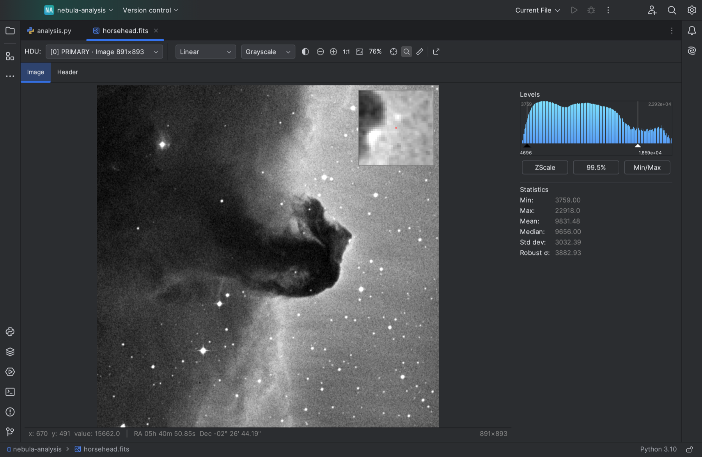

# FITS Viewer for PyCharm

View FITS images and headers right inside PyCharm and other JetBrains IDEs. Double-click a `.fits` file and it opens as an image instead of unreadable binary.



## Features

- **Every HDU:** images, tile-compressed (`.fz`) images and data cubes, with a plane picker for cubes
- **Stretches:** linear, log, square root and asinh
- **Colour maps:** grayscale, heat, viridis, magma, inferno, plasma, cividis and cool, any of them inverted
- **Levels:** ZScale by default (as in DS9 and astropy), *99.5%* and *Min/Max* presets, and a histogram with draggable black and white points
- **Cursor readout:** pixel coordinates, value and RA/Dec
- **Navigation:** zoom around the cursor, drag to pan, keyboard shortcuts
- **Tools:** magnifier, crosshair and a measuring tool that gives pixel distance and on-sky separation
- **Statistics:** min, max, mean, median, standard deviation and a robust noise estimate that ignores stars
- **Header browser** for every HDU, with filtering
- **Export as PNG** with the current stretch and colour map
- **Live reload:** the view updates when a script rewrites the file
- **Remembers your settings** across files and IDE restarts
- **Handles big files:** only the plane on screen is loaded, so large images open without slowing the IDE down

## Installation

In PyCharm (2024.3 or newer), open **Settings → Plugins → Marketplace**, search for **FITS Viewer** and click **Install**.

It works in any JetBrains IDE, including IntelliJ IDEA, CLion and WebStorm.

## Usage

Open any `.fits`, `.fit`, `.fts` or `.fz` file. Gzip-compressed FITS files with those extensions open too.

- **Top toolbar:** choose the HDU (and the plane, for cubes), the stretch and the colour map, zoom, and turn on the magnifier, crosshair or measuring tool.
- **Right-hand panel:** set the black and white levels and see image statistics.
- **Header tab:** shows the full header of the selected HDU.

| | Mouse | Keyboard |
|---|---|---|
| Zoom in / out | ⌘ (Ctrl on Windows/Linux) + scroll | `+` / `−` |
| Fit to window | Fit button | `0` |
| Actual size | Actual Size button | `1` |
| Pan | Drag, or scroll | Arrow keys (Shift to move further) |
| Measure a distance | Turn on the ruler, then drag (middle-drag still pans) | |

Click the image first so it has keyboard focus.

**Coordinates** are 0-based with `y` increasing upwards, so the value shown at `x, y` is `data[y, x]` in NumPy and astropy. Images are drawn with the first row at the bottom, like `imshow(..., origin="lower")` and DS9.

**Large images** (over 4096×4096 pixels per plane) are shown downsampled. The status bar says when this happens, and coordinates and values still refer to the original pixels.

## Building from source

You need Git and JDK 17 or newer.

```sh
git clone https://github.com/enzoperesafonso/charm-fits-viewer.git
cd charm-fits-viewer
./gradlew runIde   # opens a sandbox PyCharm with the plugin installed
./gradlew check    # runs the tests
```

## Contributing

Bug reports, feature requests and pull requests are welcome. Please run `./gradlew check` before opening a pull request.

## License

MIT. See [LICENSE](LICENSE).

The screenshot shows the Horsehead Nebula from the Digitized Sky Survey (STScI/NASA), as distributed with the [astropy tutorials](https://learn.astropy.org).
